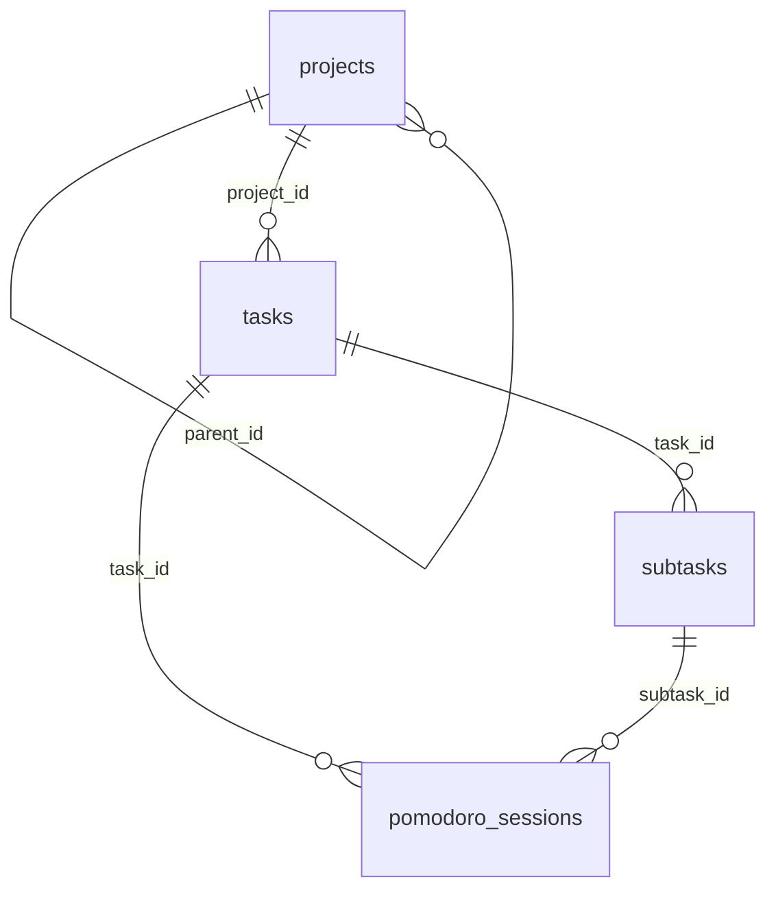

# Focus To-Do data model

Analysis of the data stored by the Focus To-Do Chromium extension
(`ngceodoilcgpmkijopinlkmohnfifjfb`) and how it maps to `schema.sql`.

## Source

- Storage: IndexedDB (LevelDB) database `PomodoroDB6` in the Chromium profile, e.g.
  `~/.config/chromium/Default/IndexedDB/chrome-extension_ngceodoilcgpmkijopinlkmohnfifjfb_0.indexeddb.leveldb`.
- Four object stores. Store names are read from the database metadata at export time.

| Object store | Name     | JSON file                | Postgres table      | Records |
| :----------- | :------- | :----------------------- | :------------------ | ------: |
| `os1`        | Project  | `projects.json`          | `projects`          |      19 |
| `os2`        | Task     | `tasks.json`             | `tasks`             |      14 |
| `os3`        | Subtask  | `subtasks.json`          | `subtasks`          |       2 |
| `os4`        | Pomodoro | `pomodoro_sessions.json` | `pomodoro_sessions` |     402 |

The counts are from the export of 2026-11-13. The project store had 24 raw log entries,
which collapse to 19 current records because only the newest version of each key is kept.
There were no delete tombstones.

## Value conventions

- **Ids** are strings, mostly UUIDs. Built-in smart lists use fixed ids such as
  `id-task-today`. They are stored as `TEXT` primary keys verbatim.
- **Timestamps** are epoch milliseconds. `0` means unset and is imported as `NULL`.
  Others become `TIMESTAMPTZ` via `to_timestamp(ms / 1000)`.
- **Durations** (`interval`, `pomodoroInterval`) are seconds. Observed session lengths
  are 600–2700 s.
- **`state`**: `-1` marks a row soft-deleted by the extension. Projects also use `0` and
  `1`. Soft-deleted rows are imported as-is (for example, one of the two projects named
  "KubeCraft" has `state = -1`). Filter with `WHERE state <> -1` for the live view.
- **`sync`**: the extension's cloud-sync flag, kept for completeness.
- Missing booleans import as `FALSE` and missing names as `''`, matching the
  `NOT NULL DEFAULT` columns.

## Field mapping

Source fields are camelCase. Columns are snake_case. Two fields were renamed to avoid
reserved words: `order` → `sort_order` and `interval` → `interval_seconds`.

### projects (`os1`)

| Field          | Type    | Column          | Notes                                   |
| :------------- | :------ | :-------------- | :-------------------------------------- |
| `id`           | string  | `id`            | PK                                      |
| `name`         | string  | `name`          |                                         |
| `objType`      | string  | `obj_type`      |                                         |
| `parentId`     | string  | `parent_id`     | FK → `projects.id`, `''` → `NULL`       |
| `color`        | string  | `color`         | hex colour                              |
| `imageName`    | string  | `image_name`    | icon name                               |
| `isDefault`    | boolean | `is_default`    |                                         |
| `expanded`     | boolean | `expanded`      | UI state                                |
| `orderingRule` | number  | `ordering_rule` |                                         |
| `type`         | number  | `type`          | distinguishes smart lists from projects |
| `order`        | number  | `sort_order`    |                                         |
| `state`        | number  | `state`         | `-1` = soft-deleted                     |
| `sync`         | number  | `sync`          |                                         |
| `creationDate` | ms      | `creation_date` |                                         |

### tasks (`os2`)

| Field              | Type    | Column              | Notes                          |
| :----------------- | :------ | :------------------ | :----------------------------- |
| `id`               | string  | `id`                | PK                             |
| `projectId`        | string  | `project_id`        | FK → `projects.id`             |
| `name`             | string  | `name`              |                                |
| `objType`          | string  | `obj_type`          |                                |
| `remark`           | string  | `remark`            | free-text note                 |
| `tags`             | string  | `tags`              |                                |
| `priority`         | number  | `priority`          |                                |
| `order`            | number  | `sort_order`        |                                |
| `state`            | number  | `state`             |                                |
| `sync`             | number  | `sync`              |                                |
| `isFinished`       | boolean | `is_finished`       |                                |
| `isExpanded`       | boolean | `is_expanded`       | UI state                       |
| `hasSubtask`       | boolean | `has_subtask`       |                                |
| `estimatePomoNum`  | number  | `estimate_pomo_num` |                                |
| `actualPomoNum`    | number  | `actual_pomo_num`   |                                |
| `pomodoroInterval` | number  | `pomodoro_interval` | seconds                        |
| `creationDate`     | ms      | `creation_date`     |                                |
| `deadline`         | ms      | `deadline`          |                                |
| `finishedDate`     | ms      | `finished_date`     |                                |
| `reminderDate`     | ms      | `reminder_date`     |                                |
| `reminders`        | string  | `reminders`         |                                |
| `rId`              | string  | `r_id`              | recurrence (`r*` fields)       |
| `rCycle`           | number  | `r_cycle`           |                                |
| `rUnit`            | string  | `r_unit`            |                                |
| `rValue`           | string  | `r_value`           |                                |
| `rFirstDeadline`   | ms      | `r_first_deadline`  |                                |
| `rStartDate`       | ms      | `r_start_date`      |                                |
| `rEndDate`         | ms      | `r_end_date`        |                                |

### subtasks (`os3`)

| Field              | Type    | Column               | Notes                       |
| :----------------- | :------ | :------------------- | :-------------------------- |
| `id`               | string  | `id`                 | PK                          |
| `taskId`           | string  | `task_id`            | FK → `tasks.id` (cascade)   |
| `name`             | string  | `name`               |                             |
| `objType`          | string  | `obj_type`           |                             |
| `isFinished`       | boolean | `is_finished`        |                             |
| `estimatedPomoNum` | number  | `estimated_pomo_num` |                             |
| `order`            | number  | `sort_order`         |                             |
| `state`            | number  | `state`              |                             |
| `sync`             | number  | `sync`               |                             |
| `creationDate`     | ms      | `creation_date`      |                             |
| `finishedDate`     | ms      | `finished_date`      |                             |

### pomodoro_sessions (`os4`)

| Field              | Type    | Column              | Notes                            |
| :----------------- | :------ | :------------------ | :------------------------------- |
| `id`               | string  | `id`                | PK                               |
| `taskId`           | string  | `task_id`           | FK → `tasks.id`                  |
| `subtaskId`        | string  | `subtask_id`        | FK → `subtasks.id`; always empty |
| `objType`          | string  | `obj_type`          |                                  |
| `interval`         | number  | `interval_seconds`  | actual length, seconds           |
| `pomodoroInterval` | number  | `pomodoro_interval` | configured length, seconds       |
| `isManual`         | boolean | `is_manual`         | added by hand                    |
| `state`            | number  | `state`             |                                  |
| `sync`             | number  | `sync`              |                                  |
| `creationDate`     | ms      | `creation_date`     |                                  |
| `endDate`          | ms      | `end_date`          | indexed                          |

## Relations



| Foreign key                     | On delete | Notes                                   |
| :------------------------------ | :-------- | :-------------------------------------- |
| `projects.parent_id`            | SET NULL  | `DEFERRABLE INITIALLY DEFERRED`         |
| `tasks.project_id`              | SET NULL  |                                         |
| `subtasks.task_id`              | CASCADE   |                                         |
| `pomodoro_sessions.task_id`     | SET NULL  | keeps session history                   |
| `pomodoro_sessions.subtask_id`  | SET NULL  | not used by the extension in this data  |

Dangling references in the source are imported as `NULL` and reported as warnings by
`focus-todo-sqlgen`.

## Integrity results

Loaded into Postgres 15.20 (`postgres-practice` container, database `focustodo`) on 2026-11-13:

- Row counts match the JSON exactly: 19 / 14 / 2 / 402.
- Orphans: 0 subtasks without a task, 0 sessions with a missing task, 0 tasks with a
  missing project.
- Loading `data.sql` a second time and re-running `schema.sql` both succeed without
  duplicates.
- Sessions span 2026-05-18 to 2026-11-12, last 600–2700 s each, and total 202.9 hours.

Integrity queries:

```sql
SELECT count(*) FROM subtasks s
 WHERE s.task_id IS NOT NULL AND NOT EXISTS (SELECT 1 FROM tasks t WHERE t.id = s.task_id);
SELECT count(*) FROM pomodoro_sessions p
 WHERE p.task_id IS NOT NULL AND NOT EXISTS (SELECT 1 FROM tasks t WHERE t.id = p.task_id);
SELECT count(*) FROM tasks t
 WHERE t.project_id IS NOT NULL AND NOT EXISTS (SELECT 1 FROM projects p WHERE p.id = t.project_id);
```
